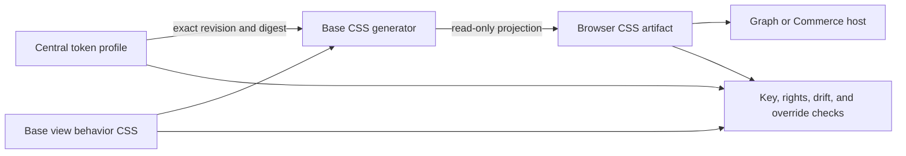

# Shared View Token Adoption

## Codebase grounding record

The central adoption plan owns token semantics, keys, rights, and projection policy. This consumer plan owns only the migration of the shared view package to an exact central pin; it does not create a second token catalog.

| Source and revision | Inspected artifact | Owner / rights | Finding and consequence |
|---|---|---|---|
| Base · `a5d0f2d87d8c6871e9639f8224f5eaee056c5b6e` | `packages/views-react/src/browser/browserDataView.css` · SHA-256 `f00b3f4c88dfa81946fdc1577aa01ff49ea3e6f996f32607bc715a5d93079b69` | Base owns shared-view behavior and its MIT-licensed source. | Nine custom-property declarations are authored here. Seven contain values, one aliases another Base key, and one is a dimension. The CSS is the only editable source; the dist copy is generator output. |
| Base · same revision | `packages/views-react/dist/browser-data-view.css` · SHA-256 `f00b3f4c88dfa81946fdc1577aa01ff49ea3e6f996f32607bc715a5d93079b69`; `scripts/build-browser-data-view.mjs` · SHA-256 `839ed0f263e6b6a668018af0c78011404a4a1db9254153ea70729c3923066257` | Base owns the projection generator. | `npm run check:browser-data-view` compares generated bytes. Preserve this as the output check and extend it to bind the central profile. |
| Base · same revision | `LICENSE` · SHA-256 `939721e4008a40f28594af8bdd7c122e388d9b22534ef1e6799dc771023691a1`; `packages/views-react/migration-source.json` · SHA-256 `4ac50e00ed25f4709852bf8ad3e5b1b118722fdb89db819b3a0de0c431b7a9e5` | Base source is MIT-licensed. Consumer data and host lifecycle remain outside this migration. | Rights are cleared for Base-owned values. This evidence grants no rights over another repository. |
| Central registry candidate · `a1c56f8ba3c3b8892897fcdbf6d61ed09784b6b7` | `prd-tad-adr-mvp-gtm-agentic-design-system.md` · SHA-256 `3f16a93449d60e0d9bbb878929d9e8b01597dded1b2326a77becdb14ed99295b`; `site/tokens/base-profile.json` · SHA-256 `3c231b5a57ae6acac862a4ede882d24657d93e45b1bc7ea32d1799ef4b32e361`; `site/vendor/base-profile.css` · SHA-256 `3e4fe01378e8e6ce347c74205659a0b0bdaa04759a2fe1f17c4060702bce6345` | The central candidate defines the nine typed Base keys and a deterministic CSS projection. | Central PR #5 is open and its Integration Gate is green; it is not yet on protected `main`. The candidate catalog has a Base profile, but Base has no consumer pin or adoption receipt. Implementation remains blocked until the central profile and generator are integrated and their exact digests are rechecked. |

## PRD

### Problem and users

**P1 — unvalidated:** maintainers can change a shared-view color, spacing value, or fallback in one CSS source while consumers retain another value. This creates drift and makes review harder. Repository inspection confirms nine explicit custom properties in the browser view source; it does not establish defect frequency, time lost, or buyer demand.

| User | Job | Current evidence |
|---|---|---|
| View maintainer | Update a shared view token once and regenerate its browser projection. | Existing source and deterministic dist check are present; central pin is absent. |
| Consumer maintainer | Consume one immutable token projection without adding a local override. | Existing consumers pin Base runtime artifacts; token-level override coverage is unproven. |
| Reviewer | Verify source, rights, generated bytes, and rollback target. | Central PR #5 contains a candidate Base profile and CSS projection; Base `main` still has no consumer pin or adoption receipt. |

### User journey and Must criteria

Need a shared-view style update → locate its central semantic key → inspect exact source revision, rights, and consumer pin → generate the Base projection → reject local redefinitions and stale bytes → restore the exact predecessor pin if adoption fails.

| VCC | Given / when / then | Named check |
|---|---|---|
| BASE-DS-01 | Given the central Base profile, when it is loaded, then all nine currently declared Base custom properties resolve to unique canonical keys, typed values, the source revision, and a digest. | `base-design-token-contract-check` |
| BASE-DS-02 | Given the exact central profile pin, when the Base browser artifact is generated twice, then its CSS bytes are deterministic and match the pinned profile digest. | `base-design-token-output-check` |
| BASE-DS-03 | Given a local declaration, fallback value, or cascade override for a registered Base token, when the Base build runs, then it fails with both the canonical key and source location. | `base-design-token-singleton-check` |
| BASE-DS-04 | Given the Base package built from the central pin, when checked at the supported consumer boundary, then view exports, component behavior, host-supplied contracts, and generated artifact sizes remain valid. | `npm run check` and existing browser-artifact checks |
| BASE-DS-05 | Given an adoption rollback, when the exact prior pin is restored, then the prior generated digest is restored without deleting either source history. | `base-design-token-rollback-check` |

**Must:** centralize all nine Base-owned custom-property definitions; preserve the existing CSS variable interface; emit a read-only generated projection; reject duplicated declarations, conflicting values, fallbacks, and cascade overrides; bind the exact predecessor pin and rollback evidence.

**Should:** show the central owner, key, revision, rights status, and Base projection digest in the consumer evidence record.

**Could:** add a local preview switch only if it uses the same central record and has no second value source.

**Won't:** move records, schemas, component state, host theme contracts, product actions, or data ownership; publish a package; add runtime network access, telemetry, accounts, model calls, paid services, or another registry.

### Success measures and economics

| Measure | Baseline | Target |
|---|---|---|
| Editable sources for the nine Base keys | Base `main` has one CSS source and no integrated central profile; an exact candidate profile exists on open central PR #5 | One central value source; generated Base output only |
| Duplicate or overridden registered keys in Base | Not fully checked | Zero; the build fails on any match |
| Generated output drift | Source/dist equality is checked | Exact central profile and generated digest are both checked |
| Contributor lookup time | Unmeasured | Median ≤5 minutes in the central plan's five-task pilot; no savings claim before measurement |
| Incremental spend / model use | $0 expected / 0 | $0 / 0 |
| Build and migration effort | Not measured | Plan cap: ≤1 focused workday after the central profile is integrated; no calendar ETA while that dependency is open |

## TAD

### Ownership and architecture

| Concern | Owner | Contract |
|---|---|---|
| Canonical token keys, values, rights, versions, and projections | Central registry | One record per key and mode; immutable revision and digest. |
| Shared-view component behavior and host interfaces | Base | Keep current component exports, DOM behavior, and consumer data boundaries. |
| Base CSS output and local verification | Base generator | Consume one pinned central profile; output is read-only and reproducible. |
| Graph and Commerce consumer adoption | Each consumer owner | Separate owner-scoped plan, exact pin, override check, rollback, and protected integration. |

The central profile is a build-time input. Base remains usable offline from its checked-in generated CSS; runtime requests never fetch token data. A missing profile, changed digest, unknown key, or absent predecessor fails the build.

### Data and execution flow

1. The central profile records each semantic key, existing CSS variable, type, value, Base source provenance, rights state, and mode.
2. Base pins the central commit and profile digest in its existing migration manifest.
3. The generator composes the component stylesheet with the exact generated token projection; it does not write token values into the component source.
4. Checks compare profile input, generated CSS, artifact manifest, and local declarations. Any mismatch fails before publication.
5. Consumer rollback restores the recorded predecessor revision and digest; the source history remains intact.

### Component and quality boundaries

The generator remains the single build owner. The validator extends existing Base checks; no second daemon, package, service, or runtime module is introduced. The generated artifact must remain below 500 kB, each source file below 600 lines, and the lane below 25 changed paths and 100 kB of shipped delta. Target incremental dependencies: zero. The local build and view remain usable offline.

### Deployment and recovery boundary

This lane changes a reusable source package and its generated artifact only. It does not deploy Graph, Commerce, or a hosted route. Protected `check` and the applicable Integration Gate prove source integration only. Recovery uses the exact predecessor Base pin and digest; production rollback remains owned by each consumer.

## ADR-01 — Central values with generated native projections

**Status:** proposed. **Decision:** move Base-owned token values into the central registry and generate Base's browser CSS from a pinned central profile. Keep Base component behavior, host-supplied semantic classes, record state, and consumer lifecycle in Base or their existing owners. Remove the nine local value declarations and registered-token fallbacks when the generated projection is integrated.

**Alternatives:** retain values in Base and mirror them centrally (two editable owners); copy Base CSS into the central site (duplicates component behavior); fetch values at runtime (breaks offline use and creates a mutable network dependency). Reject each alternative because it keeps conflicting authority or runtime coupling.

**Consequences:** central profile integration must precede the Base consumer lane; its exact commit and digest become the rollback pin. Generated CSS remains a projection. A failed or missing pin blocks release. No data or component API moves.

## MVP

The MVP is the central Base profile plus the deterministic Base projection, strict singleton checks, an exact predecessor rollback record, and current Base `check` evidence. It is not complete until the generated output and protected integration are verified. External dependency: the central profile and generator must first land on the protected central branch. No production deployment is part of this plan.

### Roadmap

| Phase | Exit condition | Stop / recovery |
|---|---|---|
| A · central profile | All nine keys have one typed value owner, exact rights, source pin, and deterministic CSS output. | Stop Base adoption if the profile is absent, stale, or incomplete. |
| B · Base projection | Base consumes the exact profile; local assignments and fallbacks are removed; `npm run check` and token checks pass. | Restore the exact predecessor pin and generated digest. |
| C · consumer adoption | Each consumer has its own scope, generated pin, duplicate/override check, rollback, and protected integration. | Stop only the failing consumer lane and restore its recorded predecessor. |

### C01–C16 coverage

| Item | Disposition | Evidence or gap |
|---|---|---|
| C01 Pain | covered | Drift is observed in source inventory; impact is unmeasured. |
| C02 Segment | covered | Shared-view maintainers; reach is unknown. |
| C03 Offer | covered | Free local generation; willingness to pay is unknown. |
| C04 Experience | covered | Exact central key and projection path; pilot remains open. |
| C05 Architecture | covered | Central source, native generator, read-only output. |
| C06 Quality and security | covered | Rights pin, fail-closed drift and override checks. |
| C07 Decision | covered | ADR-01 chooses central values and native projection. |
| C08 MVP | covered | Nine-token migration; no deployment. |
| C09 Acquisition and retention | covered | No channel or repeat-use claim. |
| C10 Operations | covered | Exact pin and predecessor rollback required. |
| C11 Obligations | covered | Base MIT evidence only; third-party notices retained. |
| C12 Economics | covered | $0 target; labor not measured. |
| C13 Capital | covered | No funding or payment collection. |
| C14 ADLC | covered | START-bound plan, protected `check`, separate integration evidence. |
| C15 Projection | covered | No separate pitch, business-plan, or financial-model claim. |
| C16 Learning | covered | Recheck after central profile integration and five-task pilot. |

## GTM

The first segment is teams maintaining shared views across repositories; this is a hypothesis. The free offer is local discovery, deterministic token projection, and fail-closed drift checks. A voluntary one-time US$1 sponsorship remains an unvalidated hypothesis with no payment request, feature gate, or recurring charge. No demand, revenue, savings, or market-size claim is made.

## Execution and planning record

**Plan state:** proposed; no consumer code has changed. Revision 0.2.0 supersedes 0.1.0 and preserves its scope and acceptance criteria while updating the central dependency. **Owner:** Base product function. **Next action:** after central PR #5 integrates, confirm that protected central `main` contains the exact Base profile and projection digests recorded above; if either differs, revise this plan before implementation. Then start a fresh Base implementation lane bound to this committed plan. The central merge is an external blocker with a recheck on protected `main`; no ETA is assigned to that wait. The central candidate and this plan do not authorize Base code integration or deployment.

| PRD-TAD-ADR-MVP-GTM | CID | RAO | Updated Date |
|---|---|---|---|
| `BASE-DESIGN-TOKEN-ADOPTION-001@0.2.0` | C: Base view token values are duplicated in authored CSS and its generated output. · I: resolve and render each value from one central owner. · D: preserve component behavior, offline output, rights, and exact rollback pins. | R: Base maintainer · A: bind the generated view CSS to the exact central profile and reject local overrides · O: one verified value source per key · check: `npm run check` plus the named token contract, output, singleton, and rollback checks. | 2026-10-30 |
