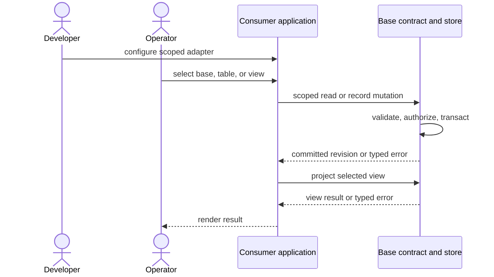
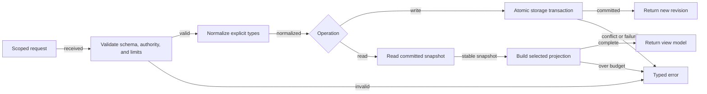
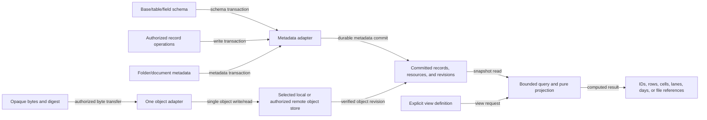
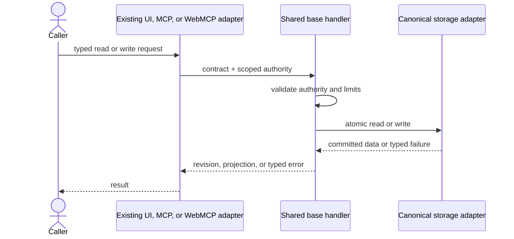

# agentic-base — Headless Data and Views

One joined specification for a portable structured-data base that owns versioned base/table/field contracts, persistence for explicitly assigned datasets, and deterministic Table, Multi-dimensional Table, Kanban, and Calendar projections. It also owns folder/file/document metadata and a future sync contract; bytes pass through one replaceable adapter. This private repository is the sole source for the existing Graph shared views and settings. Graph consumes Base React modules; Shoply in `agentic-commerce-os` consumes the bounded offline browser artifact. Table and Multi-dimensional Table share one Base grid; host data, actions, and lifecycle stay in consumers. No competing renderer is maintained.

**Recommendation:** keep `agentic-base` private and canonical, with read-only Actions access for Graph and Shoply; do not create alternate view sources. Base PR #3 merged at `815a57e89e5eb96139ccef8d6d2c74974c57c934` and contains the React views plus bounded offline browser artifact. This follow-on exposes the Table host provider through the existing package entry point. Graph remains runtime owner until its exact Base pin and renderer cutover are integrated; the retained Graph PR #1470 branch is being resolved against current `main` and must pass its `Integration Gate` before merge. Consumers retain schema, data, Markdown/frontmatter, authorization, actions, persistence policy, and outer shell lifecycle. Keep remote storage behind a hard $0 gate; no deployment or public release is authorized.

## PRD — purpose, users, and pain

**Context C-1:** products that manage structured records need a small durable base and several ways to inspect the same data. Product-specific record schemas, stores, and projections can drift; a shared contract can remove repeated infrastructure while leaving domain authority at each consumer.

**Intent I-1:** define one headless contract for explicit base/table/field schemas, durable record operations, file/folder/document metadata, and four view projections, then move the existing presentation components into this same repository without creating alternate implementations. The contract is runtime-neutral; first-party persistence runs locally and offline in a mobile browser. Future command, mention, semantic, MCP, and WebMCP surfaces call the same owner handlers rather than forking storage, sync, query, or view behavior.

**User story:** As a product developer, I want one portable contract for opted-in structured data and documents, so clients can use the same folder/file metadata, offline records, and four views without copying storage or sync logic into each product.

**Zero:** canonical Base contains its committed Agentic OS profile and the existing Graph-derived shared React views/settings. The current lane adds the Base-owned bounded browser table adapter and generated offline artifact. Graph and Shoply still need their consumer import cutovers. The old React starter remains preserved in `stash@{0}`; FloatingPanel lifecycle, complete parity, exact pins, and cross-product savings remain unproven.

**One:** a developer creates a typed base/table, writes and reopens records after a reload while offline, and obtains deterministic results in all four view kinds through one contract in a local demonstration of at most three minutes.

**Users and jobs:** product developers integrate a common record and view contract; operators manage authorized datasets and inspect records through their chosen interface; end users review work by columns, dimensions, lanes, or dates. The likely buyer is a product team that pays to reduce duplicated integration and maintenance. Buyer frequency, willingness to pay, and market size are hypotheses, not established facts.

### Pain ranking and near-built path

| Rank | Pain and evidence status | Smallest response | Close condition |
|---|---|---|---|
| P1 | Repeated table, record, and projection semantics across products; existing application grounding, but cross-product duplication and buyer pain are not yet measured | Define one base contract, one local/offline store adapter, and four projections; migrate only after rights and consumer gates pass | Two independent consumers use one pinned contract without maintaining a second store or projection engine |
| P2 | Record, filter, sort, grouping, and view behavior can drift between surfaces; support burden is unmeasured | Keep typed schema, bounded record operations, and view semantics in one owner contract; adapters translate authority and invocation only | Shared fixtures and storage conformance produce equivalent results through each adapter |
| P3 | A browser-local store does not itself provide cross-origin sharing to multiple repositories | Defer a common owner-hosted adapter until two real consumers and a free/FOSS runtime path are confirmed | Two repositories use the same owner endpoint and scoped authorization without copying the store |
| P4 | File bytes, folder metadata, and offline changes need one portable ownership and recovery model; cross-product demand is unmeasured | Define one resource contract and local object adapter; defer remote sync until a hard $0 control and conflict/recovery proof exist | One authorized resource namespace works offline and round-trips through one adapter without Git or per-consumer copies |

The ranking reflects implementation proximity, not validated demand or ROI. Stop or narrow the product if two consumers do not demonstrate the same need.

### Requirements and verification conditions

Acceptance conditions and current results are joined in the MVP Evidence Register; any incomplete condition remains open.

| ID | Priority | Required behavior | Verification condition |
|---|---|---|---|
| R1 | Must | A versioned JSON contract describes bases, tables, typed fields, records, views, limits, and typed errors with stable opaque IDs | V1: valid fixtures pass; malformed and unknown required fields fail before storage mutation |
| R2 | Must | The owner exposes bounded create/read/update/delete operations for opted-in bases, tables, and records | V2: operation fixtures prove identity stability, field validation, and explicit not-found/conflict errors |
| R3 | Must | One storage-adapter interface supports atomic commits, schema-version checks, and expected-revision writes; the first adapter uses native browser persistence | V3: reload/offline fixtures read back committed values; injected failures leave no partial write |
| R4 | Must | Table, Multi-dimensional Table, Kanban, and Calendar project the same persisted record identities deterministically | V4: golden fixtures yield expected IDs, cell counts, axes, lanes, and dates for all four kinds |
| R5 | Must | Unsupported, invalid, unauthorized, conflicting, or over-budget requests fail visibly without partial output | V5: boundary fixtures return stable typed errors and leave the prior committed state intact |
| R6 | Must | A caller's scoped authorization is checked at the owning adapter before any read or write; route names and discovery metadata grant no access | V6: denied read/write fixtures produce no data disclosure or mutation |
| R7 | Should | Existing `/`, `@`, `#`, MCP, or WebMCP surfaces call the same operation contract without protocol-specific duplicate handlers; any shared host is a separately gated increment | V7: adapter conformance calls the same handler; bindings pass collision and authority review |
| R8 | Should | A versioned JSON snapshot supports explicit export/restore before any destructive schema migration | V8: export-import round trip preserves IDs and typed values; not a sync mechanism |
| R9 | Should | One private package owns the existing Table, Multi-dimensional Table, Kanban, Calendar, Dashboard, panel, and settings visuals behind neutral host contracts; one bounded offline artifact serves vanilla-JS consumers | V9: Base shared fixture/live checks pass; one Grid source; artifact has no external imports/network and stays under 500 kB; exact Graph/Shoply pins and full parity pass |
| R10 | Should | One CI workflow runs source checks and contract/storage/projection fixtures and emits a compact receipt; future host tests use local simulated bindings by default | V10: clean CI records commit, result, and digest; package release and remote smoke/deploy require separate authority |
| R11 | Should | One resource contract models folders, document metadata, opaque object references, content digest/size/type, revision, and tombstones; object bytes stay behind one replaceable adapter | V11: local create/read/rename/move/delete/export round-trips metadata and bytes by stable IDs and verifies digests |
| R12 | Could | Explicit sync uses scoped authorization, idempotent cursors, expected revisions, resumable transfer, and typed conflicts; no silent last-write-wins or background sync in the MVP | V12: interrupted and concurrent two-client fixtures resume safely, preserve both conflicting versions, and never expose partial bytes |

### Success measures and economics

| Measure | Baseline | Target | Observation |
|---|---|---|---|
| TTV steps | Not measured; provisional path is open example → create base/table → add record → reload offline → choose view | At most 5 user actions; validate on a clean mobile-browser profile | Timed walkthrough with action count |
| First local durable view | Not measured; optional shared UI package is not built | Create, reload offline, and project a record in at most 3 minutes from clean setup | Timed mobile-browser walkthrough |
| Runtime portability | No persistence adapter exists | Same versioned contract; verify browser first, then require adapter conformance before claiming edge or Node support | Contract fixture plus each selected adapter's own conformance evidence |
| Duplicate projection owners | Existing application has an internal owner; second implementation count not established | One canonical implementation after cutover | Exact source-path inventory before and after migration |
| Durable base operations | No shared store or schema owner exists in the target repository | One opt-in owner store with atomic writes and tested reload recovery | Local/offline persistence fixtures and exact adapter inventory |
| Multi-repository shared access | Not provided by browser-local storage across origins | Base remains the sole owner; prefer Cloudflare D1 metadata/R2 objects only after two consumer proofs, scoped access, measured quotas, and a hard $0 stop | Same-owner endpoint, recovery, scoped access, no per-consumer store, no billable overage |
| Consumer integration effort | Unknown | At most 4 engineer-hours per consumer after the first adapter | Time log for two independent integrations |
| Runtime dependencies / service spend | No new package is present | Zero added runtime dependencies, network requests, paid plans, or overages for local MVP; CI uses included quota with a blocking zero-spend budget where available; no remote object host without an enforced usage cap | Lockfile, account-specific billing-control proof, and network-boundary review |
| 12-month incremental TCO | No package or adapter exists | $0 planned recurring service/dependency cost for local data and documents; remote-host TCO remains unknown and excluded | Compare free/FOSS local and self-managed paths with managed quotas, metered overages, and operator labor before any host choice |
| Token cost / month | No AI call in scope | Zero | No model dependency |
| Build effort | Unknown | One 24-hour active implementation cap after the rights/consumer gate | Time-boxed sprint ledger |
| ROI | Unscored; reach, impact, and duplication cost lack evidence | Recalculate only after two consumers report actual integration effort | Measured before/after effort and support incidents |

The ROI denominator has a proposed 24-hour build cap and zero planned recurring runtime cost for the local slice. Impact and reach remain unknown, so an ROI score is not claimed. No package work starts solely on speculative savings.

Use the guideline formula, (user impact × reach) / (build hours + monthly TCO + token cost per month). Current impact and reach are unknown; the score is therefore unscored rather than estimated from the number of repositories.

### MoSCoW and boundaries

- **Must:** versioned base/table/field/record contracts; bounded record operations; atomic local/offline persistence; four deterministic projections; typed validation; neutral fixtures.
- **Should:** consumer adapter examples, storage conformance, JSON backup/restore, resource metadata/object contract, compatibility fixtures for two products, and an optional package reusing the four existing views plus view-settings content.
- **Could:** formula fields, advanced aggregation, collaboration, remote sync, hosted multi-tenant service, and dashboard composition.
- **Won't this increment:** consumer identity systems, payment, notifications, recurrence, external calendar connections, a required UI framework, host panel shells, graph workflow editing, domain-specific business rules, model calls, paid services, or provider-locked persistence.

The core writes only datasets explicitly created in or migrated to its owned base. Existing consumer datasets remain unchanged until their source owner authorizes an exact migration, compatibility check, and cutover. Every mutation requires a scoped authorization decision from the caller's owning adapter.

### Agent-platform readiness scope

| Dimension | Scope decision |
|---|---|
| Operator runtime visibility / OS Status Surface | Excluded; this product does not aggregate harness state, capability catalogs, cost ledgers, approval gates, or circuit breakers |
| External agent access / Agent Discovery Surface | Discovery metadata may be exposed by a consumer adapter; the core makes no model call and does not execute tools |
| Tool transport federation / Gateway Federation Contract | Excluded; existing MCP or WebMCP adapters call the same base contract, with no new gateway or proxy tier |

None of these dimensions is claimed as runtime-ready.

### Ecosystem and reuse outcome

| Participant | Value exchange | Current evidence or gap | Cost, privacy, and exit |
|---|---|---|---|
| Product developer | One stable schema, persistence, and projection contract instead of another local engine | Current internal source is grounded; reuse savings are unknown | Zero-spend package; version pin remains with each caller |
| Operator and end user | Consistent ways to create, retrieve, and inspect explicitly base-owned records | Usage and accessibility outcomes need consumer observation | Base-owned records stay in the chosen local adapter unless an authorized shared-host call is explicit |
| Buyer | Potentially lower integration and maintenance effort | No WTP or paid conversion evidence | No core paywall; optional integration service requires a separate offer and payment evidence |

Measure the same integration journey before and after adoption: elapsed engineering time, repeated work, support incidents, and version-upgrade effort. Unknown savings remain unknown.

## Reference Implementation — codebase grounding

This section records implementation-specific evidence. It does not grant source, specification, or publication rights.

| Source at exact revision | Grounded state | Consequence |
|---|---|---|
| agentic-base, canonical main `3ac2a77a6d057a04b443d5dd4f8c589b91236c2f` plus preserved local implementation lane | Canonical main contains README/profile; the local lane stages the headless core, offline projection demo, and private React package. The migration manifest maps 54 files to `agentic-graph` main `0775c87540cb45d6f19156c4090e851b70c71f07`; all source/candidate digests match. `npm run check` passes 13/13 core tests, strict React TypeScript passes 51 modules, and the live preview shows the shared Table, Multi-dimensional Table, Kanban, Calendar, Dashboard, settings, FloatingPanel, and Workflow Manager surfaces. | Keep Base the sole canonical owner; complete parity and rights/distribution gates before one exact consumer pin/cutover |
| agentic-graph, current main `0775c87540cb45d6f19156c4090e851b70c71f07`, `docs/documents/prd-tad-adr-mvp-gtm-workspace-data-views.md` and current native view owners | Current main contains the shared Table core, Table row/column renderers, Kanban, Calendar, Multi-dimensional Table, Dashboard composition, saved-view controls, and Workflow Manager field sources. The local migration manifest records exact source paths/digests; Graph remains the live runtime owner. | Base centralizes the shared visual components behind neutral contracts; Graph retains schema, data, actions, and host lifecycle until an exact pin and cutover pass |
| agentic-graph, same commit, config/license-registry.json and config/surface-registry.json | Application source and unpublished specification are registered as NONE-private; private source has no public reuse grant | Written direction authorizes private internal extraction of named UI only. Keep source and package private; do not copy unpublished specifications or expose extracted source from the public Base repository until source registry, repository visibility, rights, and license gates clear |
| agentic-canvas-os, commit ac0741a399d7baba51d4b331f3dd09f064b6def5, docs/DICTIONARY-BINDING.md and docs/DICTIONARY-COMMAND.md | The @kanban-board binding keeps kanban.md as the durable task/handoff source of truth; /kanban.task, /kanban.handoff, and /kanban.sync own task-board actions | Preserve this consumer-owned task dataset and routes. It may call the shared base only for separately opted-in datasets; do not replace or duplicate its task store or lifecycle |
| agentic-commerce-os, commit 0006d363eaba69bdab2680d19c6445d2537e9ec6, `docs/native-commerce-workspaces.md` and named client/tool owners | Shoply workspaces include an origin-local proposal queue and a WebMCP guard | One candidate consumer; keep its store/runtime separate until owner-approved scope, authorization, export, and cutover proof |
| PRD/TAD/ADR guidelines, version 3.4.0 at commit 085eb0b9f2351b30d8cb5fd00c16f04f4d127280 | Requires one joined five-role artifact, grounding, coverage, flows, budgets, evidence-derived readiness, and a fail-closed release seam | PRD remains proposed; local implementation has separate evidence; no public rights transfer or release authority is inferred |

The existing application's published prose, machine-readable metadata, and private application source have different license classifications. Internal extraction of the named view UX is authorized by the user's written direction; public distribution remains blocked until source-rights metadata and the base repository's FOSS license permit it. No unpublished specification is copied.

### Reference implementation — operational choices

| Reference implementation | Current evidence checked 2026-10-16 | Recommendation |
|---|---|---|
| [GitHub Actions billing](https://docs.github.com/en/billing/concepts/product-billing/github-actions) and [spend controls](https://docs.github.com/en/billing/how-tos/set-up-budgets) | Standard hosted runners are free for public repositories; private use consumes plan quotas. Larger runners are billable and quota exhaustion may charge accounts with a payment method | Use one standard Linux workflow with no cache, artifacts, or package install. This workflow requests no paid runners or other metered features; recheck owner billing before changing its scope |
| [Edge runtime pricing](https://developers.cloudflare.com/workers/platform/pricing/), [SQL pricing](https://developers.cloudflare.com/d1/platform/pricing/), and [local SQL development](https://developers.cloudflare.com/d1/best-practices/local-development/) | Current free ceilings include 100,000 edge requests/day and 10 ms CPU/invocation; SQL includes 5 million rows read/day, 100,000 rows written/day, and 5 GB total. Local runtime/bindings support pre-deploy tests without production credentials. Limits can change | Use the local simulator for end-to-end checks; treat hosted execution only as a later optional adapter for one owner endpoint. It is a proprietary service; where production must consist only of FOSS components, use a separately verified self-managed runtime behind the same contract |
| [Object-storage pricing](https://developers.cloudflare.com/r2/pricing/), [object API compatibility](https://developers.cloudflare.com/r2/api/s3/api/), and [local object development](https://developers.cloudflare.com/r2/get-started/workers-api/) | Current standard-storage allowance is 10 GB-month, 1 million Class A operations and 10 million Class B operations/month, with no egress fee. Usage beyond included units is metered; API coverage has provider-specific differences. Local runtime simulates object bindings | Candidate for one future blob adapter; never use repository history or the structured-row store as a user-file bucket. Keep keys/API portable; do not enable remote objects while the strict no-overage gate is unmet |
| [Usage-based billing](https://developers.cloudflare.com/billing/understand/usage-based-billing/) and [budget alerts](https://developers.cloudflare.com/billing/manage/budget-alerts/) | Budget alerts are informational and do not pause or cap use. Object-storage usage beyond included allowance is billed | A notification is not a $0 guard. Remote object storage remains closed under this product's no-overage rule unless a separately verified mechanism blocks billable usage before it occurs |

Operational recommendation: use the existing code host for versioned source, product specifications, checks, and compact release receipts; it is not the customer document store or sync engine. Run one CI workflow and local edge/object simulators for credential-free end-to-end checks. If two consumers prove cross-origin need, evaluate one owner endpoint with structured metadata and one replaceable object adapter. Keep the folder contract, object references, sync cursors, checksums, and recovery format portable. Never create a second file owner, consumer-specific bucket/store, parallel API, or dual-write path. Under the current no-overage policy, do not enable remote object storage unless billable usage is mechanically blocked; an alert is insufficient. Do not create preview stores per consumer.

The commerce workspace is a consumer candidate because it has browser-local records and tables, not because a shared-base integration already exists. Its native store, review flow, and publication/payment authority remain outside this product until a separately authorized dataset migration.

## TAD — architecture and ownership

### Overview and journey mapping

**From data or document to result:** create/select an explicitly base-owned dataset or document namespace → validate scoped request → commit metadata and, where applicable, object bytes through their single-owner adapters → project a consistent record snapshot or return a verified document revision → caller renders or downloads. A consumer-owned dataset remains behind its approved adapter until an authorized migration boundary.

| Journey stage | Workflow | Data flow | Harness / invocation flow | Topology component |
|---|---|---|---|---|
| Configure | Operator selects or defines an owned base/table/view | Versioned schema and view definition → base contract | Existing UI or command validates binding | Base contract and consumer adapter |
| Read | Operator opens a view | Scoped read → persisted snapshot → deterministic projection | All routes call one handler | Base store and projection core |
| Mutate | Authorized user creates or changes a base-owned record | Scoped write + expected revision → atomic commit | Existing owner adapter supplies authority | Base persistence adapter |
| Act on domain | User triggers a product-specific action | Record ID + consumer intent → consumer domain owner | Existing consumer authorization and write handler | Consumer application |

### Topology

**D1 — topology; caption:** opted-in base-owned records flow through one persistence and projection owner; consumer datasets retain their separate owners until an approved migration.

```mermaid
flowchart LR
  A["Scoped caller request"]
  B["Existing owner adapter / MCP / WebMCP"]
  C["Versioned base contract"]
  D["Authorization context"]
  E["Storage adapter"]
  F["Base / table / field / record store"]
  G["Bounded query and projection core"]
  H["Optional shared view components / headless view results"]
  I["Consumer host surface"]
  J["Existing consumer-owned datasets"]
  A -->|"typed request"| B
  B -->|"validated contract"| C
  C -->|"operation scope"| D
  D -->|"authorized request"| E
  E -->|"atomic transaction"| F
  F -->|"committed snapshot"| G
  G -->|"selected view"| H
  H -->|"projection result"| I
  J -.->|"only after approved migration"| F
```

### Flow diagrams

**D2 — journey; caption:** a developer maps one authorized dataset, then operators read or mutate it through the same contract.

**D3 — workflow; caption:** writes commit atomically; reads project a committed snapshot; invalid or over-budget requests return typed errors.

**D4 — data; caption:** structured records, folder/document metadata, and object bytes have explicit adapter boundaries; views remain computed projections, not duplicate data.

**D5 — invocation; caption:** `/`, `@`, `#`, MCP, and WebMCP adapters call one handler; scoped authority is checked before data access.

### Diagram register

| Diagram | Class | Notation | Surface | Projects | Nodes | Edges | Clusters | Version |
|---|---|---|---|---|---:|---:|---:|---|
| D1 | Topology | Mermaid flowchart LR | Architecture documentation | No | 10 | 9 | 0 | 2 |
| D2 | Journey | Mermaid sequenceDiagram | Product documentation | No | 4 | 8 | 0 | 2 |
| D3 | Workflow | Mermaid flowchart LR | Product documentation | No | 10 | 11 | 0 | 2 |
| D4 | Data and document object flow | Mermaid flowchart LR | Architecture documentation | No | 11 | 10 | 0 | 2 |
| D5 | Invocation / harness | Mermaid sequenceDiagram | Interoperability documentation | No | 4 | 7 | 0 | 2 |

**Projection check evidence:** the guideline-owned `check-diagram-canvas-render.mjs` reported 1 Markdown file, 5 diagrams (3 structurally projecting flowcharts and 2 non-projecting sequence diagrams), 31 projected nodes, 30 projected edges, 0 clusters, 0 findings, and 0 token spend at revision 0.4.0 on 2026-10-16. This is structural parse evidence only, not a rendered runtime claim.

### Five required flows

1. **Journey:** developer maps an opted-in dataset/resource namespace and scoped adapter → operator creates a base/table/view or document → handler validates → metadata or object adapter commits → consumer receives a stable projection or verified document revision.
2. **Workflow:** receive scoped request → validate schema, authority, and limits → normalize field/date types → transact one metadata change or stage/verify bytes before metadata commit → project if requested → return a full result or typed error.
3. **Data:** schema and authorized records → metadata adapter; folder/document metadata and verified object bytes → resource adapters → versioned revisions → pure view projection or document read. No implicit migration, duplicate projection cache, or per-consumer file store.
4. **Harness:** no AI or model harness is used. Browser, device, local, edge, MCP, and WebMCP adapters validate the same JSON contract; each host supplies and records its own authority and runtime evidence.
5. **Topology / dependency:** portable data/resource contract → metadata, object, and projection adapters → optional base UI and consumer invocation adapters → host surfaces. Dependency direction is acyclic; the core imports no consumer, identity provider, or storage vendor.

### Component and contract inventory

| Component | Responsibility | Input / output | Runtime and owner | Local / delivered rung |
|---|---|---|---|---|
| Contract | Define versioned bases, tables, records, fields, view definitions, limits, results, and error codes | JSON request → schema-valid request | Headless owner | spec-complete / undocumented |
| Base schema | Define bases, tables, typed fields, stable IDs, and schema revisions | Base/table/field request → canonical schema | Headless owner | spec-complete / undocumented |
| Record operations | Validate create/read/update/delete requests and expected revisions | Scoped operation → committed revision or typed error | Headless owner; authority supplied by adapter | spec-complete / undocumented |
| Storage adapter | Atomically persist schema and records; reject unknown schema versions and conflicts | Contract operation → durable result | Headless owner; native browser adapter first | spec-complete / undocumented |
| Resource catalog and object adapter | Own folder/document metadata and revisions; transfer opaque bytes through one replaceable adapter and verify content digests | Scoped metadata + byte request → verified object revision or typed error | Headless owner; local-only extension first | proposed / undocumented |
| Sync contract | Track explicit checkpoints, tombstones, resumable transfers, and conflicts without silently overwriting concurrent changes | Scoped sync request → acknowledged cursor or typed conflict | Headless owner; remote mode deferred | proposed / undocumented |
| Query projection | Apply explicit filters and stable ordering without mutation | Record IDs + query → ordered record IDs | Headless owner | spec-complete / undocumented |
| Table projection | Return selected columns and ordered rows | Records + columns → rows | Headless owner | spec-complete / undocumented |
| Multi-dimensional Table projection | Group by explicit row and column dimensions; return cells containing stable record IDs and counts | Records + two or more explicit dimensions → axes and cells | Headless owner; distinct from a graph/network renderer | spec-complete / undocumented |
| Kanban projection | Map one explicit field to ordered lanes and cards; preserve configured empty lanes and unassigned records | Records + lane field/order → lanes and cards | Headless owner | spec-complete / undocumented |
| Calendar projection | Map date-only values to a requested month; return missing/invalid dates separately | Records + date field + month → days and unscheduled records | Headless owner | spec-complete / undocumented |
| Invocation adapter | Map existing `/`, `@`, `#`, MCP, or WebMCP routes to the shared request/result contract and scoped authority | Route call → request; result → caller | Each consumer owns its route and identity check | spec-complete / undocumented |

### Ecosystem, reuse, and dependency contract

**Developer path:** discover the contract → run the local/offline fixture → create or explicitly migrate a dataset/resource namespace → map caller authorization → pin an exact version → invoke the same owner handler through `/`, `@`, `#`, MCP, or WebMCP → verify, back up, upgrade, or retire the exact pin.

**Dependency order:** portable schema → storage adapter contract → query and view projections → optional base UI → consumer-owned invocation/identity and host-shell adapters. Runtime request/reply may flow back to the caller; build and release dependencies remain acyclic.

| Capability | Decision | Boundary and removal condition |
|---|---|---|
| Existing application view UX | Centralize neutral Table/Matrix/Kanban/Calendar, Dashboard layout/cards, saved-view/field settings, Workflow Manager list/detail presentation, and View-panel content here; Graph keeps source decoding, graph-specific widgets/schema, field models/actions, and outer panel shells; retire old view code only after exact-pin parity | No second live projection owner; record source grant, package digest, consumer pin, and retired paths |
| Durable task-board state and task commands | Retain the current source schema, store, and write lifecycle; migrate only a separately opted-in dataset | No duplicate board store, task schema, or command owner |
| Commerce record and review workspaces | Keep domain records, local drafts, and publication authority; consume the base only after a named dataset migration and owner cutover | No implicit shared database, checkout authority, or replacement commerce UI |
| Storage implementation | Native browser persistence is first for structured data and local resource bytes; metadata and object contracts keep future adapters replaceable | No vendor lock-in, paid storage, direct consumer database access, or duplicate store |
| Folder/document resource owner | One canonical namespace owns folder metadata, document revisions, tombstones, and sync cursors; bytes use one selected object adapter | No second file repository, consumer-specific bucket, or Git-backed customer document copy |
| Core external dependencies | Prefer none; browser MVP uses native APIs; any later dependency must be FOSS and pass license, byte, offline, and zero-spend checks | Remove only after exact consumer pins no longer depend on it |

MVP defaults are provisional, bounded, and fail closed: at most 2,000 records and 5 MiB serialized data per base, 128 fields per table, 64 filter nodes, 6 nested filter levels, 8 sort keys, and 500 KiB serialized input/output per operation. The caller may request lower limits, not raise these ceilings. Only primary base/table/record keys are indexed; filters and sorts scan the bounded snapshot. Runtime quota is reported as a typed error and may be lower than the product cap. Calendar input uses explicit ISO date-only values; timestamps require the caller to normalize them before projection. Over-limit or invalid requests return a typed error before any result or mutation is exposed.

The browser adapter is origin-scoped and local to the active browser profile. “Durable” means committed values survive reload while the browser retains that origin's storage; it does not promise backup, cross-device recovery, or protection from user clearing or browser eviction. It is not a cross-origin sharing mechanism. Future multi-repository consumers use one owner-hosted adapter with an explicit scoped-access contract; until that adapter is selected and verified, separate origins remain separate datasets. Projection outputs are computed on demand and are not persisted as duplicate row copies.

Folder paths are metadata, not physical object keys. Each document has a stable opaque ID, parent ID, revision, size, media type, and content digest; object keys are private adapter details. Store one local copy per namespace in the first device adapter, stream bytes without buffering entire files, and surface browser quota errors. Do not set a remote file-size limit until mobile-device and recovery benchmarks define it.

Remote sync is explicit and post-MVP: stage local changes, upload to a temporary object, verify digest, then commit metadata with an expected revision and advance the cursor. Interruption leaves the previous committed revision readable; concurrent edits return a typed conflict and preserve both versions for user resolution. No silent last-write-wins, background sync, or writes to two remote stores.

The Multi-dimensional Table is a grouped record projection, not a graph interpretation. MVP cells contain record IDs and counts only; arbitrary formulas, sums, user-authored expressions, and domain-specific aggregation are deferred.

### Quality attributes and budgets

| Attribute | Scenario and requirement | Pattern | Planned evidence |
|---|---|---|---|
| Performance | Commit/project bounded records and read/write documents within device budgets | Native transactions, bounded projections, streamed object I/O, and no stored result copies | Low-end mobile benchmark; measure each adapter before selection |
| Portability | Same valid contract is independent of browser APIs; each storage adapter conforms to the same transaction and error semantics | JSON contract and replaceable adapter boundary | Adapter conformance fixtures; browser is the only proposed first runtime |
| Offline | Create/read/update records and stage document changes without network | Native browser metadata/blob persistence; sync is explicit and deferred | Airplane-mode document and record walkthrough |
| Privacy and retention | Base-owned records and documents remain local unless an authorized owner-hosted adapter is explicitly invoked; delete and tombstone scope is explicit | No background sync, telemetry, or credential store; browser-origin isolation applies; clearing/eviction is outside durability guarantee | Authority, retention, delete, and network-boundary review |
| Security and concurrency | Denied operations expose no data; concurrent writes either commit atomically or return a revision conflict | Adapter-supplied scoped authority; transaction plus expected revision; typed quota and conflict errors | Denial, race, interruption, and recovery fixtures |
| Cost | No paid tier, service, or model; zero planned recurring cost | Native browser APIs and FOSS code; no required database service; remote metering is disabled unless a hard $0 stop is proven | License, quota, and billing-control review before release |
| Module / bundle | Lazy-load the optional browser adapter; each authored file under 600 lines and emitted chunk under 500 kB | One self-contained browser bundle and stylesheet; no consumer runtime install or network import | Build manifest and bundle-size report |
| Sprint | One owner, provisional cap of 24 active engineering hours after rights/consumer gates; at most 16 authored modules for the first local persistence + four-view slice | Re-estimate after preflight; stop at cap and record unmet VCCs; shared-host work is a later capped increment | Time and module ledger |

### Invocation and interoperability register

These are proposed binding classes, not currently registered commands or endpoints. All surfaces call the same versioned contract and handler. Each consumer reuses its existing route and tool registries; binding syntax never creates another data owner.

| Binding | Proposed contract | Effect and owner | Status |
|---|---|---|---|
| / command route | Reuse the consumer's existing command register; the base defines no global slash parser or unreviewed command name | Explicit base/table/record read or write; existing route owner supplies scoped authority | Requires registry and permission review |
| @ mention route | Typed reference to a base, table, record, or request, resolved by the existing mention owner | Reference only; cannot authorize access by itself | Proposed; collision review required |
| # semantic route | Capability or dataset classification metadata resolved by existing semantic registry | Discovery only; grants no authority | Proposed; registry review required |
| MCP operation | Same versioned base/table/record request/result contract | Read/write only with explicit adapter authorization | Existing owner or later shared-host MCP adapter; not verified |
| WebMCP operation | Same contract in a browser context | Browser-local operation or scoped call to one owner host | Existing WebMCP owner; not verified |

Adapters report unsupported schemas with a typed error. Discovery and references are not permission to read or write. New binding or semantic identifiers require an exact registry collision check; the durable task-board binding and its task commands remain separate unless that owner authorizes a dataset migration. The core adds no identity provider, global route registry, or protocol-specific duplicate handler. One future shared host must expose the same store contract to multiple repositories and must pass a free/FOSS, scoped-authorization, offline-recovery, and deployment review before it is planned for implementation.

**Compatibility cases:** pin schema and storage-format versions; preserve caller-provided row and dimension order where specified; normalize JSON encoding before digest comparison; require stable record IDs and expected revisions for mutation; return stable errors for invalid values, conflicts, and quota limits; never return partial writes or projections. Do not automatically retry an ambiguous remote write. Cross-principal access is checked by the owning adapter before any data reaches the store. A failed transaction leaves the prior committed revision intact.

### Integration, migration, and recovery

Before any code transfer, the source-rights owner must provide an explicit grant that covers the exact files, destination, FOSS license, and downstream consumers. Then the migration owner records a source-to-destination path and digest map, contract-equivalence checks, consumer pins, and the retirement target for the former implementation.

Cut over one dataset or document namespace once: record schema/path maps, export recovery data, verify record IDs/counts/types and document digests/sizes, move the authorized writer to the exact base release, and retire the replaced path in the same approved change. Do not dual-write. Only after one consumer cutover is verified may a second consumer pin the contract. No consumer may fork storage, sync, or projection behavior to work around a missing adapter; if a rights or recovery gate fails, preserve the current owner.

Code rollback restores the consumer's prior exact package pin. Data rollback is separate: failed adapter schema upgrades must leave old data readable; a destructive schema or dataset migration requires a verified export and restore path before cutover. Package rollback alone never claims to restore data. Each consumer migration retains its own exact recovery receipt.

**Value-moving flow:** the base stores records but does not authorize payment, inventory transfer, or settlement. Commerce action and publication authority remain with their owning product. A paid integration service remains a separate commercial offer with its own buyer, price, fulfillment, and payment evidence.

### Deployment strategy

The MVP has no hosted deployment: it packages a browser-local adapter and portable contract. One CI workflow runs existing source checks plus local contract/storage conformance, emits a compact commit-linked receipt, and gates one immutable release. Use local edge and object-store simulators without production credentials; keep CI within included quotas and do not use paid runners or overages. Publish only after rights, license, migration, and release checks pass; update one consumer pin at a time.

A future shared owner host is a separate increment requiring two consumer proofs, one selected metadata and object adapter, explicit access boundary, exact target, backup/restore evidence, a proven hard $0 stop, and independent deploy/rollback receipts. Local simulations come first. The current managed-object billing alert is not a hard stop, so remote file storage remains closed under this no-overage scope unless an enforceable cap or a zero-billing deployment path is proven. Remote checks/deployments require separately admitted authority; repository events do not authorize them. Use one endpoint and one canonical remote store per namespace; package rollback never implies data rollback.

### Deploy Boundary Register

| Boundary | From → to | Evidence required | Operator instruction | Rollback | State |
|---|---|---|---|---|---|
| Specification → local persistence implementation | Authoring → local code | Admitted START lane, exact rights/data boundary, FOSS license, consumer use case, and accepted VCC plan | None recorded | Return to specification-only; preserve consumer stores | Closed |
| Local code → package release | Local → release | Green source checks, FOSS license, storage/data recovery evidence, immutable version, reviewed publication authority | None recorded | Restore exact package pin; handle data recovery under separate receipt | Closed |
| Package → consumer runtime | Release → delivery | Each consumer’s exact pin, dataset scope, migration/authorization proof, and its own deploy/rollback authority | None recorded | Consumer-owned source and data rollback receipt | Closed |
| Shared owner host → multi-repo clients | Future local/edge host → consumers | Two consumer proofs, FOSS-compatible portable adapter, scoped authorization, cross-origin protocol, backup/restore, enforced $0 cap, exact deployment authority, and one endpoint/store per namespace | None recorded | Repoint clients to retained predecessor; restore data only from verified snapshot; never infer data rollback from package rollback | Not in MVP |

This specification grants no deployment, public package publication, or production authority.

## ADR — material decisions

### ADR-1: Use one existing neutral owner repository

**Status:** Proposed · **Date:** 2026-10-16

**Context:** The existing visual implementations are in Graph and are now source-mapped into the private Base lane: Table, Multi-dimensional Table, Kanban, Calendar, Dashboard, saved-view settings, reusable MainPanel settings, and Workflow Manager field presentation. The local package has no portable distribution path while its private-source/public-repository gate remains unresolved. The prior independent React starter has been removed from the active lane to avoid a competing implementation.

**Decision:** Make agentic-base the sole home for base/table/field contracts, opt-in persistence, record operations, four projections, and the reusable view package. Move the existing Table, Multi-dimensional Table, Kanban, Calendar, generic Dashboard layout/cards, saved-view/field settings, Workflow Manager list/detail presentation, View-panel content, and source-neutral projection mappings as one dependency-closed migration. Graph keeps Markdown/frontmatter decoding, graph-specific widgets and field sources, Workflow Manager field models/actions, data adapters, and outer panel shells. Do not create another repository, starter, or parallel package.

**Alternatives:** retain all schemas, stores, and views in each consumer (lowest immediate change but repeats infrastructure); create another base repository (duplicates ownership setup); adopt a provider-hosted database (adds recurring cost and coupling); or use the existing neutral owner with replaceable adapters (one future contract and store, but requires license/profile setup).

**Consequences:** one reusable contract and store owner; consumers can share only the datasets they explicitly delegate. The browser adapter is local to one origin; multi-origin sharing needs a later owner-hosted adapter. Initial setup and rights work remain. Revisit if two consumers do not adopt the same contract or the owner cannot meet free/FOSS and recovery requirements.

### ADR-2: Reuse view UX internally; gate distribution and cutover

**Status:** Proposed · **Date:** 2026-10-16

**Context:** The source registry classifies application source and unpublished specifications as private. The user authorized private internal extraction, requested `agentic-base` become private, and approved read-only Actions access for Graph and Shoply.

**Decision:** The repository is private and is the sole source of the adapted view package. Each consumer has one read-only deploy key and `AGENTIC_BASE_READ_KEY` Actions secret. Keep the package private and installable from an exact Git commit; never publish it to a registry. Before cutover, finish neutral adapters, prove parity, and pin one commit per consumer. Public distribution still needs compatible rights metadata and a FOSS license. Retire replaced Graph visuals in the same protected cutover; never maintain competing renderers.

**Alternatives:** reimplement the visuals (rejected: duplicates effort); move Graph host panels wholesale (rejected: imports graph identity, state, and workflow services); keep the view engine in each consumer (rejected: conflicting owners); extract optional neutral components and retain thin adapters (selected).

**Consequences:** the private root package exports the headless core and adapted React views; Table and Multi-dimensional Table share one grid. FloatingPanel placement/lifecycle and full parity remain open. Graph remains runtime owner until its exact pin passes the protected gate. No public release or deployment follows from this ADR.

### ADR-3: Own opted-in persistence behind a portable adapter

**Status:** Proposed · **Date:** 2026-10-16

**Context:** A headless base needs durable data for local use and future multi-repository callers. Choosing a hosted database now would add recurring cost, connectivity, data custody, and vendor coupling before shared-host demand is measured.

**Decision:** Make the base the canonical store for datasets explicitly created or migrated into it. Define one adapter contract for atomic schema/record operations and expected-revision writes. Use native IndexedDB locally/offline with zero added runtime dependencies; keep projections pure over committed snapshots and store no projection copies. For later multi-origin use, recommend one Cloudflare Worker owner endpoint with D1 metadata and R2 objects only after two consumer proofs, scoped authorization, recovery, and a mechanical $0 usage cap. GitHub remains code/CI storage, never customer data storage. Consumer identity and domain policy stay in the caller adapter.

**Alternatives:** browser local storage (rejected for synchronous string-only operations and weak transaction semantics); one provider-specific remote store (rejected for cost and lock-in); a database requirement in every consumer (rejected for duplication); native browser persistence behind a replaceable adapter (selected for the local/offline MVP); one self-hosted shared adapter (deferred until cross-origin access, auth, backup, and deployment proof exists).

**Consequences:** offline persistence is available in one browser origin; browser profiles/origins remain isolated. No shared multi-repository availability is claimed until a host adapter exists. Failed transactions preserve the last committed revision; schema-version upgrades fail closed if they cannot preserve data. Any data cutover needs an export/restore and exact authority receipt. The implementation uses no paid service or required third-party runtime package.

### ADR-4: Route every interaction through one contract

**Status:** Proposed · **Date:** 2026-10-16

**Context:** Future slash commands, mentions, semantic references, MCP, and WebMCP clients must access the same base without each defining its own persistence or operation semantics.

**Decision:** Treat `/`, `@`, `#`, MCP, and WebMCP as adapters over the same versioned operation contract. Route names and registry entries remain consumer-owned; mentions and semantic metadata never grant access. Every read/write uses the same scoped authorization and storage handler. Multi-repository clients use one canonical owner endpoint when that later host is available.

**Consequences:** one data contract supports multiple callers while keeping protocol/parser dependencies out of the core. Cross-origin clients need a verified host and permission model; until then, they cannot claim to share the browser-local store.

### ADR-5: Use one CI evidence path and gate the optional edge host

**Status:** Proposed · **Date:** 2026-10-16

**Context:** The local MVP needs repeatable evidence without adding runtime cost, while a future multi-origin service needs edge integration and real browser/client checks. Separate workflows or provider-specific schema owners would create duplicated maintenance and drift.

**Decision:** Use one GitHub source tree and CI workflow for contracts and fixtures; run Wrangler's local Worker/D1/R2 simulations for file E2E. Stay within included GitHub quota and use a blocking zero-spend budget if available for the account; otherwise disable metered hosted CI. Keep one optional Cloudflare Worker+D1/R2 adapter gated on two consumers, recovery, FOSS boundaries, and a mechanical $0 usage cap. CI never provisions, migrates, deploys, or uploads customer data.

**Alternatives:** run all checks only on developer machines (low setup, but weaker reproducibility); maintain separate CI per consumer (rejected: repeated workflow and conflicting release evidence); make hosted edge storage mandatory (rejected: violates local/offline and portability requirements); use one local-first CI path with a separately gated edge reference (selected).

**Consequences:** one receipt path reduces repeat work; local simulation has no hosted-service usage. Cloudflare Worker/D1 free quotas fail closed at limits, while R2 usage beyond its included tier can be metered; Cloudflare budget alerts notify but do not cap usage. GitHub budgets can block further metered use only when the account scope supports that control. Recheck current terms before remote effects; otherwise keep providers local-only.

### ADR-6: Keep document bytes behind one portable object contract

**Status:** Proposed · **Date:** 2026-10-16

**Context:** Folders/documents need offline metadata, portable byte access, and a future sync path without making the source repository a customer file bucket or creating one bucket per consumer.

**Decision:** The same owner defines folder/document IDs, revisions, metadata, digests, tombstones, and sync cursors. Use one replaceable object adapter and browser-local storage first. Recommended E2E path: GitHub CI plus local Wrangler Worker/D1/R2 simulators; optional remote path: one Cloudflare Worker+D1 metadata/R2 Standard object adapter after two consumers, backup/restore, conflict tests, and a mechanical cap below included quotas. Git stores product source/docs, never customer content.

| Deployment model | Cost / operations | Decision |
|---|---|---|
| Browser-local store | $0 recurring; origin-limited; no server operations | Select for offline MVP |
| GitHub source + standard public CI | One source/receipt path; no cache, artifacts, or package install | Use for code and checks, not customer files |
| Cloudflare local simulators | Wrangler runs local Worker/D1/R2; no remote service usage | Recommended for later realistic E2E |
| Cloudflare remote adapter | Finite Worker/D1 quotas; R2 over-quota usage can be metered; alerts are informational | Candidate only after mechanical $0 cap and FOSS/authority gates |
| Self-managed FOSS object service | No provider usage bill on existing free capacity, but compute, backup, patching, and operator time remain; capacity is unproven | Keep as the FOSS alternative; select only after capacity/TCO evidence |

**Consequences:** metadata and content have separate adapter contracts but one logical namespace/owner. A local cache is a revisioned replica after sync, not a second authority. No background sync, silent merge, public bucket, global credential, or per-consumer storage fork is introduced. Revisit when file demand and a genuinely fail-closed runtime are evidenced.

## MVP — smallest dependency-closed slice

**Join:** PRD requirements R1–R10 · TAD Base/schema, operations, storage/query adapters, four projections, private React package, bounded offline browser artifact, and one evidence workflow · ADR-1–6 at headless-data-base@0.9.35. R11/R12 and any remote host remain gated.

| Must slice | VCC | Evidence reference | Local / delivered rung |
|---|---|---|---|
| Versioned schema, bounded record operations, stable IDs, and typed errors | V1/V2/V5 | `npm run check`: 13/13 tests; schema, CRUD, limits, conflicts pass | dev-proven / undocumented |
| Atomic IndexedDB persistence and offline reopen | V3 | Browser: IDs survived reload/offline reload; `test-browser/idb-atomicity.html` injected an uncloneable record and confirmed abort retained the old revision with no partial record | dev-proven / undocumented |
| Four deterministic projections and reusable view controls | V4/V9 | Headless fixtures pass; the private package maps 58 Graph-derived modules, exports shared React views/settings, and uses one grid for Table and Multi-dimensional Table. The generated browser artifact is 148,590-byte JS plus 1,883-byte CSS. Full consumer parity and exact pins remain open. PR #1470 is closed with unmerged work preserved; its conflict resolution and Integration Gate are pending. | core and local UI evidence / consumer cutover open |
| Scoped authorization and no partial mutation | V5/V6 | `npm run check`: denied read, invalid-schema, stale-revision, and concurrency fixtures pass | dev-proven / undocumented |
| One CI evidence path | V10 | `.github/workflows/ci.yml` runs `npm run check`; GitHub-hosted run not yet observed | spec-complete / undocumented |

**Prior evidence record · 2026-10-16:** The earlier 44-file staging snapshot verified Dashboard responsive layout, resize keyboard/touch behavior, Table-to-Kanban shared-fixture edits, Workflow Manager search/selection, offline failure atomicity, and zero network requests. Those results remain local fixture evidence only; they do not prove consumer data parity or release readiness. The earlier source-map count and “remaining Calendar/Multi-dimensional Table” status are superseded by the current update below.

**Current update · 2026-10-16:** The private Base root package exports the headless core and source-mapped React views from one Git revision. Manifest `packages/views-react/migration-source.json` maps 54 source pairs and digests to Graph main `0775c87540cb45d6f19156c4090e851b70c71f07`; the React source is 62 files / 246,751 bytes, max 592 lines, with no Graph imports. Graph and Shoply each have a read-only Base deploy key and Actions secret. Base `npm run check` passes 13/13 core tests plus Agentic OS evals; strict React TypeScript passes on 51 modules. Live preview covers Table, Multi-dimensional Table, Kanban, Calendar, Dashboard, view settings, FloatingPanel, Workflow Manager, and 390px layouts. Agentic OS `doctor` passes. Consumer package pins and imports are not integrated yet. #1470 is closed as superseded by merged #1471 (`40d33424a5a2c76521f011ba578889b9a2470012`); Graph main `0775c87540cb45d6f19156c4090e851b70c71f07` passed `Integration Gate` in run `38869519503`. Keep Base the sole source and Graph/Shoply as consumers. FloatingPanel lifecycle, full parity/accessibility, and both cutovers remain open.

**Demo skeleton and domain-object rubric:** consumers create and reopen an authorized base/table/record offline, inspect four projections of stable IDs, invoke one existing command adapter, and verify revision, authorization, recovery, and zero network calls within 180 seconds after setup; validate the same contract with a second independent consumer after source and data gates.

**Minimum scope:** portable contract, native browser-local structured persistence, bounded record operations, four projections, and conformance fixtures; no file-sync implementation, remote object service, UI framework, or external calls. **Won't:** all items listed under “Won't this increment.”

**Readiness:** the headless core is dev-proven. One private root package source-maps Graph's Table, Multi-dimensional Table, Kanban, Calendar, Dashboard, view settings, MainPanel/Workflow Manager presentation, and FloatingPanel shell. Table surfaces share one grid. Full parity, accessibility, FloatingPanel lifecycle, exact consumer pins, file storage, remote sync, and production VCCs remain open. Graph still owns its live runtime; Shoply in `agentic-commerce-os` is the second planned consumer. No RELEASE or DEPLOY receipt exists.

## Roadmap and bounded execution

| Phase / outcome | Pain rank | Reuse / delta / owner | Prerequisite and exit | Bounds and external wait | Stop, recovery, next check |
|---|---|---|---|---|---|
| 0. Confirm source scope and consumer use cases | P1, currently hypothesized | User authorized private internal reuse of the views and settings content; no data transfer | Record exact source paths and internal grant; Base is private; require source-rights review and an approved FOSS license before public distribution, plus one dataset and two use cases before data cutover | External wait has no ETA; recheck on owner evidence | If a gate fails, keep Graph runtime intact and stop before data cutover |
| 1. Implement local base vertical slice | P1/P2 | One owner package with IndexedDB; one CI workflow; no duplicate owner | Implemented locally; close V1–V6/V10 gaps and prove failure recovery before promotion | 24 active hours; 16 modules; <600 lines/file; <500 kB/chunk; $0 runtime, no new dependencies | Stop at cap; retain unmet VCCs; no shared-host work |
| 1b. Move Graph UI into the Base owner | P1/P2 | Centralize Table, Multi-dimensional Table, Kanban, Calendar, saved-view/settings content, generic field configuration, neutral dashboard layout math and visuals; Graph supplies data/schema adapters and host shells | V9; exact source inventory, internal grant, dependency-closed stages, shared fixtures, and live UI parity; remove superseded Graph paths only with a gated consumer pin | 20 active minutes per slice; ≤15 modules; ≤500 KiB changed; <600 lines/file; <500 kB/chunk; lazy Calendar; no new service | Stop at rights or parity gates; retain the current Graph runtime and exact source until consumer pin |
| 2. Prove two consumer contracts and choose a host shape | P3/P4 | Validate table and document use cases; no data movement | Two signed-off use cases; measured local/edge constraints; FOSS runtime and scoped-auth candidate | 8 active-hour discovery cap; provider/rights wait has no ETA | If no common need/host shape fits, retain local stores and defer sharing |
| 3. Define local resource/object contract | P4 | One owner package, local metadata/bytes, no remote store | V11; mobile create/read/rename/delete/export and digest/recovery checks | 8 active hours; 8 modules; no network or paid service | Stop if browser quota, recovery, or device limits fail; remote sync stays deferred |
| 4. Prove shared adapter and explicit sync | P3/P4 | One owner endpoint, one remote object store per namespace; optional edge reference only if hard $0 stop exists | V7/V12; local simulation, scoped auth, conflict/recovery evidence, billing cap, deploy/rollback receipts | Separate 16 active-hour cap after two-consumer gate; no overage or paid plan | Stop if no mechanical $0 cap or FOSS-compatible path; keep remote sync off |
| 5. Cut over the first authorized dataset/namespace | P1/P2 | Commerce workspace is one candidate; pin one package and move one authorized scope | Export/restore, record/resource equivalence, authorization, runtime readback, and retirement receipts | One consumer lane; no dual-write or implicit draft migration | Restore prior owner and pin if parity, security, or recovery fails |
| 6. Add the second independent consumer | P1/P3 | Call the same owner endpoint and contract; no new store | V7/V12; exact pin; same-base/resource access and permission evidence | One consumer lane; at most 4 integration hours after adapter | Roll back only that pin; preserve canonical stores and prior domain owner |
| Learn | Demand and reuse | One joined successor Context | Actual time saved, support cost, and buyer response | No forecasted revenue or unpaid enthusiasm treated as payment | Continue, narrow, or stop on measured reuse and WTP |

**First-dollar ranking:** (1) a fixed-scope integration and compatibility service for a buyer with an observed integration cost; (2) paid maintenance/support only after repeat demand; (3) no paid core feature or hosted tier. The first path is nearest to the scoped capability but remains unvalidated. Record the buyer, price, offer, fulfillment cost, and payment before calling demand or revenue proven. No amount is set at this revision.

### First-dollar choice record

**Constraints:** preserve the free/FOSS core and zero planned recurring runtime spend; local browser persistence uses a native API. A shared host is self-hosted or otherwise proven free/FOSS before selection; no hosted tier or paid addon is assumed. Integration and support remain candidates, but neither has verified buyer evidence.

**Outranking:** a one-time integration service has fewer prerequisites than ongoing support because it can be scoped to one observed consumer integration; this is a provisional experiment order, not a validated commercial winner. A hosted tier fails the stated constraints.

**Argumentation:** the supporting claim is proximity to the existing integration work; the counterclaim is that no reachable buyer, price, or payment is evidenced. The choice remains unresolved until a buyer interview and priced offer produce evidence. No price or revenue forecast is selected.

**Roadmap owner:** this joined artifact owns the product roadmap at continuity ID and revision above. Consumer backlogs may reference it but do not restate its product decisions.

## GTM — evidence and learning

| Stream | Segment exists now | Distance to first dollar | Mechanism | Demand | Collected revenue |
|---|---|---|---|---|---|
| Integration and compatibility service | Candidate product teams; no buyer list verified | Nearest if an existing team has a repeated integration problem | Unproven | Unvalidated | None evidenced |
| Ongoing maintenance/support | Candidate adopters; repeat need unverified | After first successful integration | Unproven | Unvalidated | None evidenced |
| Paid hosted service or core paywall | Excluded by zero-spend/FOSS posture | Not applicable this increment | Not offered | Not tested | None |

**Learn loop:** each completed consumer integration records time, failed/repeated actions, support cost, and outcome; a priced offer records acceptance or refusal; only a confirmed payment records revenue. Feed results into a successor Context, not a backward edit of this revision.

## PRD-TAD-ADR-MVP-GTM coverage record

**Join:** headless-data-base@0.9.35 · **As of:** 2026-10-16 · **Owner:** Portable structured-data and file product function

**0:** A portable record store and view contract is a grounded technical opportunity; external pain, reach, and WTP are unknown. **1:** One developer creates and reopens an authorized dataset offline, then projects the same records into four views; observe two consumer integrations, data recovery, and time-to-first-view after an authorized package release.

| Domain | Decision | Source section | Evidence or gap | Owner | Next check |
|---|---|---|---|---|---|
| C01 Purpose, customer, pain | covered | PRD purpose | Existing application capability; external pain and WTP unvalidated | Product function | Interview two consumer teams |
| C02 Market and timing | deferred | GTM | No segment sizing or timing evidence | GTM function | Size after interviews |
| C03 Offer and alternatives | covered | ADR-1, GTM | Reuse beats new repository on ownership; no priced offer evidence | GTM function | Price one integration service |
| C04 Product and experience | covered | PRD requirements R4, R9 | The local preview renders the shared view/settings surfaces; the migration manifest maps 58 modules to Graph main, including FloatingPanel shell visuals. The browser artifact is under 500 kB. Graph remains runtime owner until its pin lands. Dashboard data/configuration, Markdown editing, MCP commands, Mission composition, field models/actions, and outer panel lifecycle remain consumer-owned. Full parity and exact pins remain open | Product function | Finish the authorized Graph branch integration, then pin Base in Graph and Shoply |
| C05 Architecture and data | covered | TAD, ADR-3, ADR-6 | Canonical store, resource/object contract, consumer authority boundary, origin isolation, and future sync gate defined | Architecture function | Verify adapter and two consumer boundaries |
| C06 Quality, security, and AI | covered | TAD, ADR-2 | No AI; typed errors, internal-use boundary, and public license gate defined | Architecture function | Update source registry before sharing |
| C07 Decisions and tradeoffs | covered | ADR-1–6 | Canonical owner, optional UI package, adapter boundary, authority, CI, and object-store boundary recorded | Product function | Reopen on package or billing evidence |
| C08 Smallest validated slice | covered | MVP | Local implementation and partial VCC evidence recorded; gates remain open | Delivery function | Close V3/V10 and remaining VCCs |
| C09 Acquisition and retention | deferred | GTM | No channel or retention evidence | GTM function | Observe first two integrations |
| C10 Business operations | covered | TAD, Roadmap | One owner, version pins, CI evidence, object recovery, sync conflicts, and separate data/code rollback path defined | Operations function | Record recovery effort |
| C11 Organization and obligations | deferred | ADR-2 | Rights, license choice, and contributor obligations unresolved | Rights owner | Written grant and license |
| C12 Financial viability | deferred | Economics, ADR-6 | Local path costs $0; remote object overages and operating/support costs remain unqualified | Finance function | Measure two integrations and prove a hard $0 host cap |
| C13 Capital and milestones | covered | Roadmap | Bootstrap; no paid infrastructure or funding ask in scope | Product function | Revisit only if spend is proposed |
| C14 ADLC execution | covered | Deploy Boundary Register | Agentic OS `doctor` passes hook integrity and canonical identity; deep observation binds the active lane. No RELEASE/DEPLOY receipt | Delivery function | Reuse deep observation after material drift; require exact release/deploy receipts |
| C15 Audience projections | deferred | Coverage record | No deck, business plan, or financial model evidence | Product function | Create only for a named audience |
| C16 Learning and next increment | covered | GTM | Successor Context and stop conditions defined | Product function | Review after two consumer observations |

**Coverage:** headless-data-base@0.9.35; 16/16 domains dispositioned, 11 covered, 5 deferred, 0 N/A. Coverage is not product readiness.

## Planning record

### 2026-10-16

| PRD-TAD-ADR-MVP-GTM | CID | RAO | Updated Date |
|---|---|---|---|
| headless-data-base@0.2.0 | C: view and record ownership are application-coupled · I: define one reusable headless base, persistence adapter, and four projections · D: keep one canonical owner; gate all source/data migration and shared hosting | R: product planning · A: product function defines contracts and local-first persistence · O: reviewable five-role specification · check: C01–C16 coverage, storage recovery, VCC register present | 2026-10-16 |
| headless-data-base@0.3.0 | C: local MVP needs repeatable, zero-spend evidence and future shared-host proof · I: use one CI path and optionally evaluate one edge adapter behind the portable store contract · D: preserve one owner, local-first behavior, free/FOSS boundaries, and hard $0 gates | R: product planning · A: product function defines contracts; operations verifies quota and deploy receipts · O: operational choices grounded in official docs; no host enabled · check: CI, account billing, FOSS, and authority gates before any effect | 2026-10-16 |
| headless-data-base@0.4.0 | C: folder/document bytes need one offline owner and future sync contract · I: use local object simulation for E2E; evaluate one remote adapter only with hard $0 billing stop · D: no customer blobs in source control, no duplicate stores, no billable overage | R: product planning · A: product function owns one data/resource contract; operations verifies storage quota and recovery · O: remote object host remains closed · check: R11/R12, FOSS, two consumers, and authority receipts | 2026-10-16 |
| headless-data-base@0.5.0 | C: implement the local/offline base without opening release or deployment · I: one IndexedDB owner, four views, one GitHub check path; recommend local Cloudflare simulators for later resource E2E · D: preserve neutral contracts, no duplicate owner, no paid service/overage | R: user-authorized local implementation · A: product function owns contract; operators own effects · O: 13 tests, offline reload, and injected-abort proof; V10 and release gates open | 2026-10-16 |
| headless-data-base@0.7.0 | C: reuse the existing Graph UI without creating another repository or engine · I: centralize neutral views/settings and optional dashboard primitives in Base; keep Graph-specific schema/widgets and host shells in consumers · D: one package, one gated cutover, private local staging until rights/visibility/license clear | R: user-authorized internal extraction direction · A: Base owns neutral UI and contracts; consumers own adapters/effects · O: live source UI verified; extracted-source parity, public distribution, consumer pin, and release remain open | 2026-10-16 |
| headless-data-base@0.9.12 → 0.9.13 → 0.9.18 → 0.9.23 → 0.9.24 → 0.9.25 → 0.9.26 → 0.9.27 | C: centralize Graph Dashboard visuals and reuse while PR #1470 retains overlapping view paths · I: source-map the DashboardCanvas content shell, MainPanel settings frame and shared section header, Workflow Manager list/detail shell, selection/flip frame, section shell, metric/card shells, widget editor, template palette, resize control, and pure row/column math into Base; inject toolbar, settings, sizing, drag policy, and persistence; keep Graph Dashboard data, Markdown editing, MCP commands, and Mission composition in the consumer and route their shared visual imports to Base · D: preserve private source and Graph runtime pending integration | R: authorized private UI extraction · A: Base owns shared visual components and pure row/column layout math; Graph supplies host configuration, controls, editor fields/actions, drag/drop policy, and domain state · O: strict Dashboard TypeScript and `npm run check` pass; all 44 mapped source/candidate digests match; the responsive DashboardCanvas shell has a 1,232px content area at 1280px and remains within a 288px content area at 320px; at 1280px the board renders two 610px columns; at 320px its 288px board stacks both cells with no page overflow; neutral layout helper checks return snapped 480px and fluid `calc()` widths; resize keyboard/touch checks pass; no console warnings/errors or fetch/XHR. PR #1470 remains OPEN and GitHub reports mergeable=CONFLICTING (merge state DIRTY), at base `85cae4f78c40b5161b387b5f734978bc404f422d`, head `483a024b62ca498db7f0987d5ed8328c6f94a217`, with no reported checks. Graph `AGENTS.md` directs agents to stop when an active PR owns the semantic scope; keep the PR open and wait for integration before Graph source edits or consumer cutover. No Graph source cutover, commit, push, release, or deployment |
| headless-data-base@0.9.29 | C: close the Graph PR integration question using current branch and gate evidence · I: run Base checks and Graph `ci:integration`; inspect PR branch protection and conflict resolution · D: keep the Base package private and retain PR #1470 open under the prior user direction | R: user-directed conflict-resolution/integration request · A: GitHub requires the `Integration Gate`; its status is reported by GitHub on the PR head · O: Base `npm run check` passed (13/13), strict React TypeScript passed (51 modules), and 54/54 migration digests match Graph main. Graph `ci:integration` passed on main, whose tree equals the locally conflict-resolved candidate; `ci:affected` reported 0/11 owner checks because no paths changed. PR #1470 remains OPEN/DIRTY/CONFLICTING; GitHub reports no PR checks, and branch protection requires `Integration Gate`. Resolving conflicts in favor of current main produces zero changed paths, so no nonempty candidate exists to merge; PR left open per prior explicit direction. No push, release, cutover, or deployment | 2026-10-16 |
| headless-data-base@0.9.30 | C: resolve the requested Graph PR integration without reintroducing a duplicate/stale view implementation · I: compare exact PR history with protected Graph main, run its exact-head integration checks, and close the superseded duplicate · D: retain the private Base package and do not merge stale Graph branch content | R: user-directed conflict and integration request; prior instruction to keep #1470 open is superseded by the newer merge request · A: #1471 merged the functional commits from #1470, and the protected branch still requires `Integration Gate` · O: #1471 merge `40d33424a5a2c76521f011ba578889b9a2470012` records all functional #1470 commits plus later Calendar refinement; stale #1470 head compares as 10 files, 44 insertions, 347 deletions versus that merge snapshot. Exact-head local integration reached `ci:affected` but failed closed on `blocked-workflow-selection-member-binding`; no GitHub status exists for #1470. Closed #1470 as superseded, retained its branch, and made no source changes. `npm run reap` remains blocked by >256 local lane refs. No Base/Graph cutover, publish, release, or deploy | 2026-10-16 |
| headless-data-base@0.9.35 | C: consumers need stable React entry points to reuse Base-owned Graph views · I: export the existing Table host provider through the established package subpath and pin consumers to an exact merged revision · D: keep Base private; Graph and Shoply consume one owner without local visual variants | R: user-directed private repository and read-only consumer access; latest request authorizes conflict resolution, Integration Gate, and merge of the preserved Graph branch · A: Base owns shared view presentation; consumers keep their domain models, data, authorization, actions, persistence policy, and outer shell lifecycle · O: PR #3 exact source/artifact remains merged at `815a57e`; Table host provider export is added here; Graph renderer cutover and Shoply exact pin are still open; no public release, remote storage, or deployment | 2026-10-16 |

## Open decisions and gates

1. Keep Graph source registry and migration digests aligned before each consumer pin; Base is the only owner of the extracted visuals.
2. Finish shared fixture/live parity, FloatingPanel lifecycle, accessibility, and exact pins before removing Graph's local implementations.
3. Shoply in `agentic-commerce-os` is the second consumer; keep its domain schema, actions, and data in Commerce. No dataset migrates without authority, recovery proof, and a cutover receipt.
4. Public release requires source-rights review and an approved FOSS license. Remote storage/sync remains closed until two-consumer, recovery, authorization, and hard-$0 gates pass.
5. Revisit demand and MVP acceptance after both integrations; deployment and production need separate evidence.
